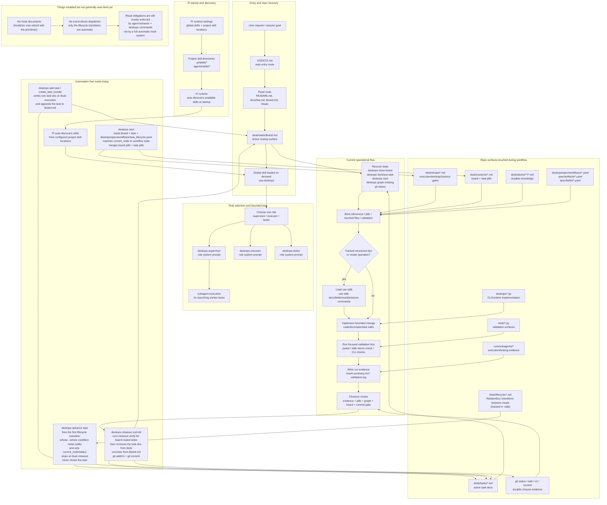

FILE:desk/tasks/task-readme-y-docs-dejan-de-nombrar-spec-artifacts-spec-fields-y-specregistry-borrados-en-cc30.md
---
sldb:
  by: agent
  at: '2026-11-16T06:00:43Z'
  authority: generated
  via: save_document_payload
id: task-readme-y-docs-dejan-de-nombrar-spec-artifacts-spec-fields-y-specregistry-borrados-en-cc30
status: draft
summary: ''
tags:
- workspace:desk
- artifact:task
- host:robocop2
current_node: ritual-execution
history: []
references: []
depends_on: []
pills: []
files:
- README.md
- docs/knowledge-graph/desk-source-graph-vocabulary.md
- docs/diagrams/process/current-agent-workflow-and-automation.md
- docs/diagrams/process/current-agent-workflow-and-automation.mmd
task_type: task.docs
inherits_from: []
inherit_acceptance_context: false
atoms: []
from_drawer: desk/drawer/tasks/task-docs-y-readme-todav-a-nombran-spec-artifacts-y-spec-fields-borrados-en-cc30.md
---

# README y docs dejan de nombrar spec/artifacts, spec/fields y SpecRegistry, borrados en CC30

## Rationale

_Explain why this task exists or the business driver behind it._

Item del drawer (2026-11-06): CC30 (squash 93cc1943) borro deskops/spec/artifacts, deskops/spec/fields, SpecRegistry, deskops/specs/loader.py y deskops/specs/mermaid.py, y paso id_pattern, status_default y tags a atributos de clase de cada modelo en deskops/models. Siguen nombrados en README.md:90, docs/knowledge-graph/desk-source-graph-vocabulary.md:63, docs/diagrams/process/current-agent-workflow-and-automation.md:63 y su .mmd:29.

## Goal

_Describe the concrete result this task must produce._

Esos archivos remiten a los atributos de clase de los modelos (deskops/models) y a deskops/doc_access.py; el grep de validacion queda vacio. El .mmd no tiene spec fuente (spec2viz se archiva, 80d32903), asi que se edita junto con su .md y el commit lo dice.

## Scope

_State what is in scope and what is out of scope._

Entra solo README.md y lo que haya bajo docs/ (el grep de validacion define el conjunto). Destino de cada mencion: si habla de id_pattern, status_default o tags por artefacto -> los atributos de clase del modelo en deskops/models; si habla de cargar o resolver artefactos -> deskops/doc_access.py; si habla de SpecRegistry o del loader -> se borra la frase y se remite a deskops/models. El mensaje del commit dice 'el .mmd no tiene spec fuente; se edita junto a su .md'. No entra: reescribir los diagramas ni migrarlos a specir. Solo se corre test_operator_manual.py.

## Implementation Path

_Outline the expected implementation route or affected surface._

1) Correr el grep de validacion. 2) Reescribir cada mencion. 3) Volver a correr el grep y los tests de docs.

## Validation

_List the checks required before this task can close._

- cd /mnt/ssd/proyectos/SLDB_1/deskops && ! grep -rn 'spec/artifacts\|spec/fields\|SpecRegistry' README.md docs/
- cd /mnt/ssd/proyectos/SLDB_1/deskops && TMPDIR=/dev/shm ../.venv/bin/python -m pytest -q tests/test_operator_manual.py

## Done When

_Name the observable condition that makes the task complete._

El grep no encuentra nada y test_operator_manual pasa.

FILE:README.md
---
atoms:
- id: atom-docs-are-human-facing-atom-materializations
  role: documents
- id: atom-deskops-owns-workflow-not-document-infrastructure
  role: documents
- id: atom-sldb-is-read-write-edit-surface
  role: documents
- id: atom-spec2viz-mirrors-sldb-for-diagrams
  role: documents
- id: atom-cli-should-match-spoken-workflow-language
  role: documents
- id: atom-desk-test-root-precedence-is-explicit
  role: documents
---
# deskops

Source atoms are declared in the YAML frontmatter.

Workflow-domain instance built on top of `sldb`.

This repo owns the operational surfaces that should not live inside generic `sldb` infrastructure: `desk/`, deferred drawer work, workflow-native models, pills, rituals, atoms, and materializers.

Understanding `deskops` requires understanding `sldb` first: `sldb` owns structured Markdown infrastructure for querying, writing, and editing modeled documents, while `deskops` owns the workflow-domain instance built on top of it.

## Layout

- `desk/` - active and deferred workflow surfaces
- `docs/` - durable deskops-specific documentation
- `tests/` - workflow-domain tests

Durable guides currently include:

- `docs/quickstart.md`
- `docs/operator-manual.md`
- `docs/faq.md`
- `docs/workflow-policy-reference.md`
- `docs/atoms.md`
- `docs/how-to-report.md`
- `docs/how-to-test-ux-cli.md`

Pi/project agent guidance includes:

- `.pi/skills/use-deskops/SKILL.md`
- `.pi/skills/deskops-task-lifecycle/SKILL.md`
- `.pi/skills/deskops-inbox-coordination/SKILL.md`
- `.pi/skills/deskops-health-and-drift/SKILL.md`
- `../sldb/.pi/skills/use-sldb/SKILL.md`
- `docs/agent-system-prompts/README.md`

Parallel opencode copies also exist under `.opencode/skills/`.

Claude Code uses `.claude/skills/deskops-workflow/` (`SKILL.md` plus `references/deskops-cli.md`,
`references/spec2viz-cli.md` and `references/vocabulary.md`). This is the versioned copy: on each machine,
`~/.claude/skills/deskops-workflow` is a symlink to it, so the skill is the same in every repo that uses deskops
and on every machine that pulls this repo:

```bash
ln -sfn "$(pwd)/.claude/skills/deskops-workflow" ~/.claude/skills/deskops-workflow
```

Edit the skill here, not in `~/.claude/skills/`, and commit it with the CLI change it documents.

## SLDB Boundary

`sldb` owns reusable structured-document infrastructure:

- `StructuredNLDoc` model contracts
- reversible Markdown templates using `⸢rev•field⸥` markers
- structured document creation and updates
- field extraction from Markdown into model payloads
- field-level query, update, append, clean, create, and remove commands
- section ownership for fields
- store tracking, integrity hashes, recovery, and composition primitives

`deskops` owns workflow-domain surfaces:

- active tasks and boards
- rituals, the task lifecycle graph (rituals as states, sldb relations as gated transitions), and gates
- transient pills and inbox notes
- durable atoms and materializers
- drawer triage for deferred work

Fields are already first-class in `sldb`. Do not create desk-local field documents just to make fields reusable, queryable, writable, or editable. Use `sldb docs`, `sldb fields`, `sldb sections`, `sldb ast`, and tracked document payloads for that.

Use `sldb` as the preferred write/edit path for modeled Markdown: `sldb docs create`, `sldb docs update`, `sldb fields update`, `sldb fields append`, `sldb fields clean`, and `sldb fields remove` should be preferred over ad hoc file edits whenever the document is tracked by a `StructuredNLDoc` model.

If that SLDB path does not work, capture the failure in the sibling `sldb` repo's inbox with the failing command, expected behavior, actual behavior, and relevant model/document references. Do not silently bypass SLDB or reimplement the missing field/document behavior inside `deskops` before the SLDB issue is recorded.

`deskops/spec/fields/` may define artifact schema vocabulary for the deskops compiler, but `desk/fields/` should not become a human-facing workflow surface or duplicate SLDB's field model.

Model changes should use SLDB's model workflow where possible:

- `sldb models add <model-ref> --store .sldb --pythonpath .`
- `sldb models template edit <ModelName> --input <template.md> --store .sldb --pythonpath .`
- `sldb models fields add <ModelName> <field> --type <type> --description <text> --store .sldb --pythonpath .`
- `sldb models fields remove <ModelName> <field> --store .sldb --pythonpath .`
- `sldb models validate <ModelName> --store .sldb --pythonpath .`
- `sldb models validate <ModelName> --promote --store .sldb --pythonpath .`

Use physical search for concrete names, paths, field paths, document names, and section titles:

```bash
sldb find title --in physical --store .sldb --pythonpath .
sldb find desk/atoms --in physical --store .sldb --pythonpath .
```

Use semantic search for model semantics, document tags, and meaning-oriented discovery:

```bash
sldb find topic:atoms --in semantic --store .sldb --pythonpath .
sldb find type.knowledge.atom --in semantic --store .sldb --pythonpath .
```

Use `--in both` when unsure, and `--global` when the local store should include linked/federated stores.

Maintain the semantic store with:

```bash
sldb stores check --store .sldb
sldb stores update --store .sldb --pythonpath .
sldb stores build --check --store .sldb
```

## Spec2viz Boundary

`spec2viz` owns structured diagram generation in the same way `sldb` owns structured Markdown operations.

Use `spec2viz` when a diagram has or should have a structured YAML source. The YAML spec is the source of truth; Mermaid, PlantUML, SVG, or other rendered outputs are projections.

Use `spec2viz` for:

- validating structured diagram specs
- rendering human-facing diagrams from semantic YAML
- keeping diagrams aligned with their underlying architecture/process model
- avoiding hand-maintained duplicate Mermaid or PlantUML surfaces

Common commands:

```bash
spec2viz validate <diagram-spec.yaml>
spec2viz render <diagram-spec.yaml> --backend mermaid --out <output-dir>
spec2viz render <diagram-spec.yaml> --out <output-dir>
spec2viz schema --out spec2viz.schema.json
```

For `docs/diagrams/`, prefer this rule:

- structured YAML specs are editable source
- `.mmd`, PlantUML, SVG, or rendered diagram files are generated projections
- if a generated diagram is wrong, fix the YAML source or the renderer, not only the generated output
- if `spec2viz` cannot express or render the needed diagram, capture the gap in the sibling `spec2viz` repo's inbox before creating a deskops-specific workaround

The intended parallel is:

- `sldb`: structured data plus model contract -> Markdown document and field/query/edit surface
- `spec2viz`: structured diagram spec plus diagram contract -> rendered visual artifact

Both exist to reduce drift by making the structured source explicit and regenerating the human-facing projection from it.

## Install

Install `deskops` from this repo checkout:

```bash
pip install -e .[dev]
```

If `sldb` is not already available on the machine, `deskops` can bootstrap it from the sibling checkout at `../sldb`.

The store under `.sldb/core/` is derived and not versioned; `.sldb/store.yaml` declares it. After cloning, build it once:

```bash
sldb stores build --store .sldb
```

Recommended first-use flow:

```bash
deskops bootstrap
deskops init .
deskops add task --title "First task" --task-type task.docs --goal "..." --scope "..." --validation "..."
```

`deskops add task --task-type` names the type (default `task.code`): the task's type declares the evidence `deskops closeout` will verify (`docs/quickstart.md` walks through it).

`deskops bootstrap` will:

- install or repair `sldb` from the sibling checkout when it is missing
- initialize the global store at `~/.sldb` when needed
- register the `deskops` models into that global store

`deskops init <path>` will:

- ensure the bootstrap prerequisites are ready
- create a local `.sldb/` store under the target repo when missing
- scaffold `desk/` when missing

## Per-project desk config precedence

Each desk can declare tracked shared config in `desk/config.json` and optional machine-local overrides in `desk/config.local.json`.

For root/sandbox resolution, precedence is authoritative:

1. explicit CLI flag such as `--root`
2. `DESKOPS_TEST_ROOT`
3. `desk/config.local.json`
4. `desk/config.json`
5. built-in defaults

`desk/config.local.json` is intended for disposable local overrides such as sandbox settings; tracked shared expectations such as `versions.desk_format` belong in `desk/config.json`.

## CLI

Run the installed entrypoint as `deskops`, or use the module form from this repo checkout.

```bash
deskops --help
python -m deskops --help
```

Current commands (`deskops --help` is authoritative; `docs/operator-manual.md` documents every verb):

- `deskops about`, `deskops faq` - orientation
- `deskops doctor` (`deskops status` is a deprecated alias)
- `deskops bootstrap`, `deskops init`
- `deskops message send/list/read/ack`
- `deskops promote inbox-to-drawer-task`, `deskops drawer remove`, `deskops retire`, `deskops issue close/list`
- `deskops add/edit/list/show <artifact>` - tasks, pills, rituals, boards, atoms, materializations, repositories, inbox-notes, faq-docs, steps
- `deskops bind pill`, `deskops next`, `deskops advance task`
- `deskops closeout commit/supersede/retire/verify`
- `deskops repo register/whoami/remove`
- `deskops desk install/migrate/replace/update`
- `deskops atoms ...` (namespaces, crossroads, protoatoms, create/split/merge/delete/validate/reorganize/tree)
- `deskops graph build/neighbors/missing/reflect`
- `deskops materialize`, `deskops drift check`
- `deskops runtime init/status/attach/stop/workers/supervise/template`

## Testing

```bash
pytest
```

FILE:docs/knowledge-graph/desk-source-graph-vocabulary.md
# Desk Source Graph Vocabulary

This document is a human-facing materialization of these atoms:

- `desk/atoms/workflow-model/atom-docs-are-human-facing-atom-materializations.md`
- `desk/atoms/workflow-model/atom-kgdb-owns-relations-between-knowledge-surfaces.md`
- `desk/atoms/workflow-model/atom-deskops-owns-workflow-not-document-infrastructure.md`

ID: desk-source-graph-vocabulary

## Purpose

This document defines the first controlled vocabulary for connecting desk artifacts to source files in a KGDB-backed property graph. The vocabulary is intentionally small: it names node kinds, edge role families, relation direction rules, and confidence/provenance fields before any extractor, fixture, CLI command, or graph runtime exists.

## Boundary

SLDB remains the source of truth for modeled Markdown, semantic tags, document sections, and document payloads. Deskops may derive graph facts from those SLDB-owned surfaces, but it must not reimplement SLDB parsing or semantic tag derivation.

KGDB owns graph persistence, snapshots, and traversal. Deskops owns workflow-specific graph vocabulary and relation extraction rules. The graph is a property graph contract first; OWL or ontology mappings are deferred until the property graph is useful.

## Node Kinds

Node kinds are lower-case strings stored as `kind`. The first vocabulary uses file-level source nodes only; symbol-level nodes are out of scope until file-level extraction is validated.

| Kind | Meaning | Stable identity source |
|---|---|---|
| `atom` | Curated one-question knowledge atom under `desk/atoms/`. | Atom `ID` field. |
| `task` | Active routed work item under `desk/tasks/`. | Task `ID` field. |
| `issue` | Deferred or inbox/drawer work item under `desk/drawer/issues/` or owning repo inbox/drawer. | Issue title slug or explicit `ID` when present. |
| `doc` | Durable human-facing Markdown document that is not a spec, diagram, task, issue, atom, or ritual. | Repository-relative path. |
| `diagram` | Rendered or source diagram document, including Mermaid-backed diagram docs. | Repository-relative path. |
| `spec` | Contract/specification artifact under `spec/` or docs that explicitly define expected structure or behavior. | Repository-relative path plus spec id when present. |
| `ritual` | Process/state document under `desk/rituals/`, including the task-lifecycle states. | Ritual `ID` field. |
| `sldb_model` | SLDB model or document schema used as graph input. | Model name or repository-relative `.sldb` path. |
| `cli_command` | User-facing deskops command surface. | Command token path, for example `deskops atoms check-tags`. |
| `source_file` | Implementation source file that is not primarily a test or config file. | Repository-relative path. |
| `test_file` | Test source file. | Repository-relative path. |
| `config_file` | Configuration, registry, or policy file that changes behavior without being executable source. | Repository-relative path. |

## Node Identifiers

Every graph node id uses the format `<kind>:<identity>`, where `<kind>` is one node kind from this vocabulary and `<identity>` is the smallest stable identifier available for that kind. Identifiers are deterministic, project-local, and stored as plain strings.

Use explicit document ids when the modeled artifact owns one. Use project-root-relative POSIX paths for file-backed nodes whose identity is the file itself. Do not include absolute paths, working-directory prefixes such as `./`, generated line numbers, content hashes, or symbol locators in file-level ids.

Path identities are normalized before prefixing:

- Use `/` as the separator.
- Keep the path relative to the project root.
- Preserve filename case as stored in git.
- Remove redundant `.` path segments.
- Do not add a trailing slash.

Identifier stability follows the identity source. Nodes backed by explicit ids remain stable across file moves as long as the explicit id remains unchanged. Path-backed nodes intentionally change id when the project-root-relative path changes; a future graph migration or equivalence edge may record continuity, but this vocabulary does not create aliases. Command-token ids change when the user-facing command path changes. Ritual ids change when the ritual's declared `ID` changes.

| Kind | Identifier format | Example |
|---|---|---|
| `atom` | `atom:<atom-id>` from the atom `ID` field. | `atom:atom-documents-point-to-atoms` |
| `task` | `task:<task-id>` from the task `ID` field. | `task:task-002-define-graph-node-identifiers` |
| `issue` | `issue:<issue-id-or-title-slug>` from explicit `ID` when present, otherwise the issue title/file slug. | `issue:issue-integrate-kgdb-for-desk-source-knowledge-graph` |
| `doc` | `doc:<project-relative-path>` for durable Markdown docs that are not a more specific kind. | `doc:docs/knowledge-graph/desk-source-graph-vocabulary.md` |
| `diagram` | `diagram:<project-relative-path>` for diagram source or rendered diagram docs. | `diagram:docs/diagrams/codebase/codebase-knowledge-surfaces.mmd` |
| `spec` | `spec:<project-relative-path>` plus `#<spec-id>` only when the file carries multiple explicit specs. | `spec:spec/artifacts/atom.yaml` |
| `ritual` | `ritual:<ritual-id>` from the ritual `ID` field. | `ritual:ritual-execution` |
| `sldb_model` | `sldb_model:<model-name>` for declared SLDB models; use `sldb_model:<project-relative-path>` only when no model name exists. | `sldb_model:AtomDoc` |
| `cli_command` | `cli_command:<space-separated-command-token-path>` using the user-facing command path. | `cli_command:deskops atoms check-tags` |
| `source_file` | `source_file:<project-relative-path>` for implementation source files that are not primarily tests or config. | `source_file:deskops/operations.py` |
| `test_file` | `test_file:<project-relative-path>` for test source files. | `test_file:tests/test_atom_materialization.py` |
| `config_file` | `config_file:<project-relative-path>` for configuration, registry, or policy files. | `config_file:desk/atoms/tag-namespaces.yaml` |

Symbol-level ids are out of scope: no node kind allows a `#` suffix, and ids do not authorize general function, class, method, or variable nodes.

## Edge Roles

The graph reuses the existing document-to-atom role vocabulary where the meaning overlaps. It does not create a competing atom relation model: atoms do not own outgoing relations, and larger surfaces point to atoms or to implementation surfaces.

An edge role is the controlled value stored in the edge `role` property. The role names below are the first allowed vocabulary for deskops graph extraction; later tasks may append roles, but they must not invert these directions or redefine the atom-reference roles tracked by `issue-formalize-atom-reference-role-vocabulary`.

### Direction Rule

Every edge points from the artifact carrying the relation evidence to the artifact being referenced, realized, validated, invoked, routed, or configured. The source node answers "where did this relation claim come from?" and the target node answers "what surface does that claim concern?"

Do not emit duplicate inverse edges for convenience. KGDB traversal should answer reverse questions such as "what implements this atom?" by traversing incoming `implements` edges. A reverse-looking role is allowed only when it has distinct evidence and distinct meaning, such as `source_for` from a source artifact to a generated projection instead of `generated_from` from the generated projection to the source artifact.

### Role Catalog

| Role | Family | Canonical direction | Example source kind | Example target kind | Declared evidence | Inferred evidence | First extractor |
|---|---|---|---|---|---|---|---|
| `references` | Knowledge use | Referencing surface -> referenced surface. | `doc` | `atom` | Explicit `atoms` frontmatter (the canonical atom-reference field; roles: `references`, `documents`, `specifies`, `constrains`, `validates`), Markdown link, or semantic reference field. | Content scan that recognizes an atom id or stable node id. | yes |
| `documents` | Knowledge use | Explanatory surface -> atom or documented surface. | `doc` | `atom` | Explicit atom reference role, documentation frontmatter, or curated relation map. | Heading/link context that clearly describes the target. | yes |
| `specifies` | Knowledge use | Specifying surface -> specified surface. | `spec` | `cli_command` | Spec section, model declaration, or task output that names the target. | Path or title similarity between a spec and target surface. | yes |
| `constrains` | Knowledge use | Constraint source -> constrained surface. | `doc` | `task` | Ritual, policy, pill, or task dependency that explicitly limits behavior. | Content scan that finds imperative policy language naming a target. | yes |
| `supports` | Knowledge use | Supporting evidence/context -> supported claim or surface. | `doc` | `atom` | Explicit related-atom, evidence, or rationale reference. | Nearby reference text that appears to justify a target. | no |
| `uses` | Knowledge use | Dependent surface -> dependency surface. | `source_file` | `sldb_model` | Import, config declaration, or documented dependency. | Static content scan for model or command names. | no |
| `materializes` | Materialization | Concrete artifact -> abstract atom/spec/task it materializes. | `doc` | `atom` | Materializer output metadata or explicit generated artifact declaration. | Path convention tying a generated artifact to a source atom. | no |
| `implements` | Materialization | Implementation surface -> atom/spec/task/behavior it implements. | `source_file` | `spec` | Explicit code comment, command registry entry, task output, or spec implementation mapping. | Filename or import similarity; filename similarity alone is always low confidence. | no |
| `renders` | Materialization | Rendered projection -> semantic surface it presents. | `diagram` | `doc` | Render metadata, diagram source reference, or projection declaration. | Matching `.md` and `.mmd` path pairs. | no |
| `generated_from` | Materialization | Generated artifact -> generator or source artifact. | `diagram` | `source_file` | Generated-file metadata, materializer output, or build manifest. | Path convention or generated filename pattern. | no |
| `source_for` | Materialization | Source artifact -> generated or derived artifact. | `source_file` | `diagram` | Source manifest, generator registry, or explicit projection declaration. | Paired source/output path convention. | no |
| `validates` | Validation | Validation evidence -> claim, atom, task, source file, or behavior it validates. | `test_file` | `atom` | Test marker, explicit validation metadata, or task validation list. | Test name or assertion text that names the target. | yes |
| `tests` | Validation | Test file -> source file, command, or behavior under test. | `test_file` | `source_file` | Test import, fixture target, or explicit test metadata. | Test filename matching source filename. | no |
| `violates` | Validation | Conflicting artifact -> claim, atom, spec, or policy it violates. | `issue` | `spec` | Explicit issue, finding, diagnostic, or check result naming the violated target. | Content scan that detects likely conflict language. | no |
| `invokes` | Operation | Caller, task, doc, or command -> command it invokes. | `task` | `cli_command` | Task instruction, CLI registry, script call, or command documentation. | Content scan for command-shaped text. | yes |
| `defines` | Operation | Defining artifact -> model, ritual, command, schema, tag namespace, or vocabulary item it defines. | `config_file` | `sldb_model` | Schema file, registry, model file, or vocabulary document. | Path convention under a known definition directory. | yes |
| `routes` | Operation | Board/index/workflow surface -> task or issue it routes. | `doc` | `task` | Board row, index entry, or routing metadata. | Path convention inside an active task directory. | yes |
| `configures` | Operation | Config file or setting surface -> runtime/source/command surface it configures. | `config_file` | `cli_command` | Config key, registry entry, or documented setting target. | Content scan that associates a setting with a target name. | no |

### Atom Reference Field And Roles

Artifacts declare atom references in one frontmatter field, `atoms`. A reference is a bare atom id or a mapping with `id` and an optional `role`. The only allowed roles are `references`, `documents`, `specifies`, `constrains`, and `validates`; the default is `references`.

`related_atoms` is a legacy alias: `deskops drift check` reports it as `legacy_atom_reference_field` and points at `atoms`. `source_atoms` remains the `MaterializationContractDoc` field and is not a general artifact field. An unknown role is reported as `invalid_atom_reference_role`; the extractor maps it to `references` so graph extraction continues.

Reverse atom traceability (which docs, tasks, tests, and diagrams reference an atom) is derived from declared edges at read time. Atoms do not store outgoing use-site lists, and consumers must read the derived projection rather than writing consumer lists back into atom documents.

### Declared And Inferred Roles

Declared roles come from explicit source-owned metadata or authored text that names both the relation and the target. Examples include an atom reference with `role: documents`, a board row routing a task, a task validation section naming tests, or a config/model file defining a schema. Declared edges should use `source_kind` values such as `declared`, `sldb_semantic`, or `manual`, and may be `high` confidence when the target id is stable and unambiguous.

Inferred roles come from extraction rules that interpret evidence rather than directly reading a declared relation. Examples include matching a test filename to a source file, pairing `.md` and `.mmd` diagram paths, or finding command-shaped text in a task body. Inferred edges should use `source_kind` values such as `path_rule`, `content_scan`, or `test_name`; they require a `notes` value when confidence is `medium` or `low`.

Low-confidence inferred roles are provisional graph hints, not workflow truth. They must not be used to mark tasks complete, close issues, or claim implementation coverage without a declared or manually reviewed edge. Filename similarity alone must remain `low` confidence and must not create high-confidence `implements`, `validates`, or `tests` edges.

### First-Extractor Allowed Roles

The first extractor may emit only roles marked `yes` in the role catalog: `references`, `documents`, `specifies`, `constrains`, `validates`, `invokes`, `defines`, and `routes`.

These roles are allowed first because they can be read from declared document surfaces, SLDB semantic inputs, explicit task validation text, command references, definition files, and board/index routing without implementing source-code analysis, graph runtime behavior, fixtures, CLI graph commands, or self-reflection. The first extractor must not emit `implements`, `tests`, `materializes`, `renders`, `generated_from`, `source_for`, `uses`, `supports`, `violates`, or `configures` until a later task defines the necessary evidence rules and validation fixtures.

### Required Edge Metadata

Every emitted edge must include `role`, `source_kind`, `confidence`, and `provenance_path`. Declared edges should include a `provenance_locator` whenever the relation comes from a field, section, board row, or task validation line. Inferred edges should include a `provenance_locator` when a rule matched a path pair, filename, test name, command token, or content span, and must include `notes` unless confidence is `high`.

## Relation Direction Policy

Edges should point from the artifact carrying the relation evidence to the artifact being referenced, realized, validated, invoked, routed, or configured. This preserves the existing atom rule: documents and other surfaces point to atoms; atoms do not point outward to every consumer.

Use inverse traversal in KGDB for questions such as "what implements this atom?" rather than storing duplicate reverse edges. Add a reverse edge only when it has a distinct role and distinct evidence, such as `source_for` on a source artifact versus `generated_from` on a generated artifact.

When a relation could be read both ways, prefer the direction that answers "which artifact made this claim?" The source node should be the file or modeled surface where the claim was declared or inferred.

## Confidence And Provenance Policy

Every edge must carry enough metadata to distinguish declared facts from weak inference. The initial required edge properties are:

| Property | Required | Meaning |
|---|---|---|
| `role` | yes | One controlled role from this vocabulary or a later compatible extension. |
| `source_kind` | yes | Extraction source: `declared`, `sldb_semantic`, `path_rule`, `content_scan`, `test_name`, `declared_materialization_target`, or `manual`. Source file nodes from materialization targets use `declared_materialization_target`. |
| `confidence` | yes | `high`, `medium`, or `low`. |
| `provenance_path` | yes | Repository-relative file path where the relation evidence was found. |
| `provenance_locator` | no | Optional line, section id, frontmatter key, test name, or symbol locator. |
| `extractor` | no | Name/version of the future extractor or manual process that emitted the edge. |
| `notes` | no | Short human-readable reason when confidence is not `high`. |

Declared document metadata, explicit task dependencies, board routes, and explicit config/model declarations may be `high` confidence. Relations inferred from path conventions or filename similarity must not exceed `medium`; filename similarity alone must be `low` and must not create high-confidence `implements` edges.

## Extension Policy

New node kinds and roles may be appended when a task or extractor needs them. Existing names must not be renamed casually because graph snapshots and downstream traversal depend on stable vocabulary. Extensions should document direction, source evidence, confidence expectations, and whether the role overlaps with the atom-reference role vocabulary.

KGDB does not need special built-in knowledge of these names beyond accepting extensible node and edge properties. If a missing KGDB or SLDB capability is discovered while implementing graph extraction or traversal, record it in that system's owning inbox/drawer before continuing.

## Non-Goals

- Do not implement extractors, fixtures, CLI commands, graph build commands, graph neighbor commands, or graph runtime behavior in this task.
- Do not define symbol-level source graph nodes yet.
- Do not make KGDB parse SLDB documents or derive SLDB semantic tags.
- Do not make deskops own graph persistence or traversal semantics.
- Do not formalize OWL, ontology reasoning, or RDF mappings now.
- Do not replace the existing document-to-atom reference convention; reuse it where role meanings overlap.
- Do not close the separate atom-reference role vocabulary issue; this document only avoids conflicting with it.

FILE:docs/diagrams/process/current-agent-workflow-and-automation.md
---
source_atoms:
- atom-docs-are-human-facing-atom-materializations
- atom-rendered-diagrams-are-projections
- atom-spec2viz-mirrors-sldb-for-diagrams
- atom-clean-agents-start-from-minimum-workflow-set
- atom-first-safe-action-follows-read-route
- atom-phase-gates-prevent-agent-skipping
- atom-tasks-enable-zero-context-subagents
provenance: docs/diagrams/process/current-agent-workflow-and-automation.mmd
---

# Current Agent Workflow and Automation Map

This diagram document is a human-facing materialization of these atoms:

- `desk/atoms/workflow-model/atom-docs-are-human-facing-atom-materializations.md`
- `desk/atoms/workflow-model/atom-rendered-diagrams-are-projections.md`
- `desk/atoms/workflow-model/atom-spec2viz-mirrors-sldb-for-diagrams.md`
- `desk/atoms/workflow-model/atom-clean-agents-start-from-minimum-workflow-set.md`
- `desk/atoms/workflow-model/atom-first-safe-action-follows-read-route.md`
- `desk/atoms/workflow-model/atom-phase-gates-prevent-agent-skipping.md`
- `desk/atoms/workflow-model/atom-tasks-enable-zero-context-subagents.md`

This diagram shows the **current** deskops workflow as it exists today across Pi skill discovery, desk recovery, global surface skills, role system prompts, task execution, structured-document work, deterministic workflow automation, and closeout.

It intentionally distinguishes:

- what Pi auto-discovers
- what the repo asks agents to load on demand
- what deskops automates today
- what is still enforced by agent behavior rather than code



## Surfaces touched by stage

### 1. Pi discovery

- Pi runtime settings
- `.pi/skills/*/SKILL.md`
- `.agents/skills/*/SKILL.md`

What is automatic here:

- Pi discovers skills from configured project locations at startup.

What is not automatic here:

- Pi does not reliably load the full content of every skill unless prompted by task match or explicit use.

## 2. Entry and recovery

Primary surfaces:

- `AGENTS.md`
- `README.md`
- `docs/faq.md`
- `desk/tasks/Board.md`
- `desk/rituals/execution.md`
- `desk/rituals/testing.md`
- `desk/rituals/closeout.md`

Primary skill:

- `use-deskops`

## 3. Role-specific work

### Supervisor lane

Primary role prompt:

- `deskops-supervisor`

Main surfaces:

- `desk/tasks/Board.md`
- active task docs in `desk/tasks/`
- run evidence in `runs/subagents/`
- git evidence for closeout review

### Executor lane

Primary role prompt:

- `deskops-executor`

Main surfaces:

- assigned task in `desk/tasks/`
- bound pills in `desk/contexts/`
- bound atoms in `desk/atoms/`
- code/spec/doc files named by the task
- validation targets in `tests/`
- evidence in `runs/subagents/`

### Tester lane

Primary role prompt:

- `deskops-tester`

Main surfaces:

- assigned task
- testing and closeout rituals
- tests
- validation logs and handoff evidence

### Worker-lane launch

Primary skill:

- `subagent-execution`

Main surfaces:

- `runs/subagents/<timestamp>-<task-id>/`
- `board.txt`, `task.txt`, `next.txt`, `graph.txt`, `git-status.txt`, `stdout.log`, `stderr.log`, `result-summary.md`, `validation.log`

## 4. Structured-document lane

Use `.pi/skills/use-sldb/SKILL.md` when the task touches:

- `StructuredNLDoc` models
- tracked Markdown docs
- SLDB field operations
- store update/check flows
- model templates and model fields

Typical touched surfaces:

- `.sldb/`
- tracked Markdown docs under `desk/`
- model code under `deskops/models/`

## 5. Workflow automation that exists today

### `deskops add task`

Implemented by `create_task_bundle()`.

Automatically creates and writes:

- the task doc, at the lifecycle entry node `ritual-execution`
- board update adding the task to `desk/tasks/Board.md`

Nothing else is written per task: the lifecycle is the desk's sldb graph under `desk/lifecycle/`, written once by `deskops init` or `deskops desk update --apply`.

### `deskops next`

Implemented by `next_action_report()` plus `deskops/spec/workflows/task_lifecycle.yaml`.

Automatically:

- reads the active board
- resolves the task
- matches `current_node` to a workflow state
- reports ritual, phase, next actions, and merged pills

### `deskops advance task`

Implemented by `advance_task()` plus `deskops/lifecycle.py`.

Automatically:

- reads the transitions leaving the task's `current_node` from the sldb edge index
- evaluates each transition's `--where` condition with sldb (`where_matches`)
- fires the first one that holds: sets the status it declares and the next ritual
- stops at `ritual-closeout` and points at `deskops closeout commit`; it never closes the task
- reports the blocked gate when none holds

### `deskops closeout commit`

Implemented by `ClosureService` in `deskops/services/closure.py`.

This is the only close path. `advance` stops at `ritual-closeout` and points here; a forced transition to the terminal node is refused.

Automatically:

- for a board-routed task, runs `deskops closeout verify` and refuses to commit when any gate fails
- removes the task from `desk/tasks/Board.md`
- untracks the task from the store and removes the task document from disk
- makes one closing commit, linked to `--run-dir` evidence or marked manual with `--no-run --reason`

The closeout gate requires test evidence, a link for every changed file (an atom/materialization link or a routed follow-up reference), and a commit reference that resolves to `HEAD` or an ancestor. Because the gate runs before the closing commit exists, the commit reference must point at an earlier commit, such as the task's promotion commit.

## 6. Hooks: current truth

Hook documents were retired together with the other per-task primitives. There is no event-driven hook runtime; the only automatic workflow rules are the lifecycle transitions and their conditions in the sldb graph.

So the current workflow should be described as:

- **partly automated by the lifecycle graph and specific deskops code paths**
- **ritual obligations beyond the transition conditions are still enforced by agent behavior**

## Practical interpretation

Today the workflow is a hybrid:

- **Pi** auto-discovers skills
- **agents** still have to choose/load the right skill and follow repo rituals
- **deskops** automates several deterministic task-lifecycle operations
- **the lifecycle graph** automates task transitions; most other ritual enforcement is still behavioral/manual

FILE:docs/diagrams/process/current-agent-workflow-and-automation.mmd
flowchart TB
    subgraph PiBoot["Pi startup and discovery"]
        pi_settings["Pi runtime settings\nglobal skills + project skill locations"]
        skill_dirs["Project skill directories\n.pi/skills/*\n.agents/skills/*"]
        pi_runtime["Pi runtime\nauto-discovers available skills at startup"]
    end

    subgraph Entry["Entry and repo recovery"]
        user_req["User request / session goal"]
        agents["AGENTS.md\nrepo entry route"]
        read_route["Read route\nREADME.md, docs/faq.md, Board.md, rituals"]
        board["desk/tasks/Board.md\nactive routing surface"]
        repo_skill["Global skill loaded on demand\nuse-deskops"]
    end

    subgraph RoleSelection["Role selection and bounded lane"]
        role_lock["Choose one role\nsupervisor / executor / tester"]
        sup_skill["deskops-supervisor\nrole system prompt"]
        exec_skill["deskops-executor\nrole system prompt"]
        test_skill["deskops-tester\nrole system prompt"]
        subexec_skill["subagent-execution\nfor launching worker lanes"]
    end

    subgraph StateSurfaces["Repo surfaces touched during workflow"]
        tasks["desk/tasks/*.md\nactive task docs"]
        rituals["desk/rituals/*.md\nexecution/testing/closeout gates"]
        pills["desk/contexts/*.md\nboard + task pills"]
        atoms["desk/atoms/**/*.md\ndurable knowledge"]
        specs["deskops/spec/workflows/*.yaml\nspec/artifacts/*.yaml\nspec/fields/*.yaml"]
        runtime["desk/lifecycle/*.md\nRelationDoc transitions between rituals\n(tracked in .sldb)"]
        code["deskops/*.py\nCLI/runtime implementation"]
        tests["tests/*.py\nvalidation surfaces"]
        runs["runs/subagents/*\nexecution/testing evidence"]
        git["git status / add / rm / commit\ndurable closure evidence"]
    end

    subgraph AutomaticToday["Automation that exists today"]
        auto_discovery["Pi auto-discovers skills\nfrom configured project skill locations"]
        auto_bundle["deskops add task / create_task_bundle\nwrites one task doc at ritual-execution\nand appends the task to Board.md"]
        auto_next["deskops next\nreads Board + task + deskops/spec/workflows/task_lifecycle.yaml\nmatches current_node to workflow state\nmerges board pills + task pills"]
        auto_advance["deskops advance task\nfires the first lifecycle transition\nwhose --where condition holds (sldb)\nand sets current_node/status\nstops at ritual-closeout\nnever closes the task"]
        auto_close["deskops closeout commit\nruns closeout verify for board-routed tasks\nthen removes the task doc from desk\nunroutes from Board.md\ngit add/rm + git commit"]
    end

    subgraph NotAutomaticYet["Things modeled but not generally auto-fired yet"]
        hook_docs["No hook documents\n(HookDoc was retired with the primitives)"]
        no_hook_engine["No event-driven dispatcher\nonly the lifecycle transitions are automatic"]
        rituals_still_manual["Ritual obligations are still mostly enforced\nby agent behavior + deskops commands\nnot by a full automatic hook system"]
    end

    subgraph ExecutionFlow["Current operational flow"]
        recover["Recover state\ndeskops show board\ndeskops list/show task\ndeskops next\ndeskops graph missing\ngit status"]
        bind["Bind references / pills / touched files / validation"]
        maybe_sldb{"Tracked structured doc\nor model operation?"}
        sldb_skill["Load use-sldb\nuse sldb docs/fields/models/stores commands"]
        implement["Implement bounded change\ncode/docs/spec/task edits"]
        validate["Run focused validation first\npytest / sldb stores check / CLI checks"]
        handoff["Write run evidence\nresult-summary.md / validation.log"]
        close_gate["Closeout review\nevidence + pills + graph + board + commit gate"]
    end

    user_req --> agents --> read_route --> board --> repo_skill
    pi_settings --> skill_dirs --> pi_runtime --> auto_discovery
    auto_discovery --> repo_skill
    repo_skill --> role_lock
    role_lock --> sup_skill
    role_lock --> exec_skill
    role_lock --> test_skill
    sup_skill --> subexec_skill

    board --> recover
    tasks --> recover
    rituals --> bind
    pills --> bind
    atoms --> bind
    specs --> bind
    code --> implement
    tests --> validate
    runs --> handoff
    git --> close_gate
    runtime --> auto_advance

    recover --> bind --> maybe_sldb
    maybe_sldb -- yes --> sldb_skill --> implement
    maybe_sldb -- no --> implement
    implement --> validate --> handoff --> close_gate

    auto_bundle --> tasks
    auto_bundle --> board
    auto_next --> rituals
    auto_next --> pills
    auto_advance --> tasks
    auto_close --> tasks
    auto_close --> board
    auto_close --> git

    hook_docs --> no_hook_engine --> rituals_still_manual
    close_gate --> auto_close

FILE:instruccion
Cold-bundle de la tarea task-readme-y-docs-dejan-de-nombrar-spec-artifacts-spec-fields-y-specregistry-borrados-en-cc30: con el TaskDoc, los rituales enrutados por el Board, las pills ligadas, los átomos ligados y los archivos que el TaskDoc nombra, reformula el encargo, lista ambigüedades con cita textual del input y da el DRY-RUN sin ejecutar nada. No ejecutes nada.

Sección de validación del TaskDoc:
- cd /mnt/ssd/proyectos/SLDB_1/deskops && ! grep -rn 'spec/artifacts\|spec/fields\|SpecRegistry' README.md docs/
- cd /mnt/ssd/proyectos/SLDB_1/deskops && TMPDIR=/dev/shm ../.venv/bin/python -m pytest -q tests/test_operator_manual.py

